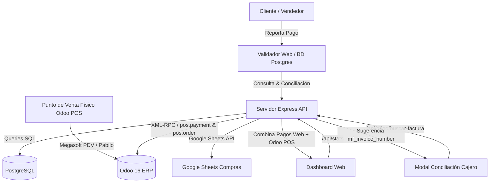

# Mapa Conceptual - Validador de Pagos y Conciliación Odoo

## 1. Título y Propósito
**Validador de Pagos** es la plataforma central para la gestión, validación, conciliación y auditoría de pagos (Transferencias bancarias en Bolívares, Pago Móvil, Divisas en efectivo y métodos electrónicos como Megasoft y Pabilo) de la empresa, sincronizada en tiempo real con **Odoo ERP (v16 POS y Facturación)** y Google Sheets (para solicitudes de compras).

Los usuarios principales son:
- **Vendedores**: Reportan pagos de clientes, consultan estado y crean solicitudes de productos.
- **Cajeros / Administración**: Concilian pagos contra extractos bancarios y validan en Odoo POS.
- **Compras / Gerencia**: Supervisan compras, autorizaciones y métricas globales de ingresos en el Dashboard.

---

## 2. Arquitectura General y Tecnologías

### Stack Tecnológico
- **Frontend**: React (Vite) + Tailwind CSS + Lucide Icons + Wouter / React Router + TanStack Query.
- **Backend**: Node.js + Express + TypeScript.
- **Base de Datos**: PostgreSQL gestionado con Drizzle ORM.
- **Integraciones Clave**:
  - **Odoo 16 ERP**: XML-RPC / JSON-RPC sobre modelos `pos.payment`, `pos.order`, `account.move`, `res.partner`, `product.product`.
  - **Google Sheets API**: Registro bidireccional para solicitudes de productos y compras.
- **Despliegue & CI/CD**: Coolify (Docker) con Webhooks conectados a GitHub.

### Diagrama de Flujo de Datos

---

## 3. Características Globales y UX-UI
- **Layout Adaptativo**: Priorización de vista horizontal widescreen para escritorios de caja y administración, eliminando scroll innecesario.
- **Filtrado Dinámico**: Filtros por rango de fechas (Hoy, Ayer, Esta Semana, Este Mes, Personalizado) y por vendedores/cajeros.
- **Búsqueda Inteligente**: Autocompletado de clientes, montos y sugerencia automática de facturas fiscales emitidas en Odoo.
- **Seguridad**: Autenticación JWT por roles (`admin`, `cajero`, `compras`, `vendedor`).

---

## 4. Detalle por Módulos y Lógica de Negocio

### 4.1. Dashboard de Métricas y Validación (`/api/stats`)
El dashboard consolida dos universos de pagos:
1. **Pagos Registrados en la Web (`pagos` table)**:
   - **Verificados en Banco (Manual)**: Pagos revisados y aprobados directamente por los cajeros contra estados de cuenta bancarios (Banesco, Venezuela, Mercantil, etc.).
   - **Sin Factura**: Pagos aprobados en la web donde el cajero no escribió el número de factura fiscal al momento de conciliar.
2. **Pagos en Punto de Venta Odoo POS (`pos.payment`)**:
   - **Megasoft POS**:
     - Método de pago en Odoo: `BANCO VENEZUELA PDV`
     - Diario contable: `BANCOS MEGASOFT (TRANSITORIA DE POS)` (ID 124)
     - Procesa cobros directos de tarjetas y puntos de venta Megasoft en tienda.
   - **Pabilo POS**:
     - Moneda Nacional (Bs): `Pabilo - VENEZUELA CTE` (Diario 62).
     - Criptomonedas / USDT: `Pabilo - Onprotec Binance` (Diario 165).
     - Refleja pagos validados y automatizados en el punto de venta.

### 4.2. Asistente y Autocompletado de Facturas Odoo (`/api/odoo/buscar-factura`)
- **Problema que resuelve**: Los cajeros a menudo conciliaban pagos en la web sin escribir la factura, provocando alertas de "Sin Factura" cuando la venta ya estaba facturada en la máquina fiscal de Odoo.
- **Funcionamiento**:
  - Al abrir el modal de conciliación, el backend consulta `pos.order` buscando órdenes del cliente dentro de la fecha con montos coincidentes (o cercanos).
  - Extrae el número de factura fiscal (`mf_invoice_number`, ej. `70695`, `12711`) y el nombre de la orden (ej. `CAJA-01/58670`).
  - La interfaz muestra una tarjeta con botón **"Usar"**, rellenando el campo `factura` en un solo clic.

### 4.3. Reglas Universales de Integración con Odoo
- **Nombres de Productos**: Está estrictamente prohibido alterar o limpiar nombres de productos devueltos por Odoo con funciones como `cleanName` o regex. Siempre se debe utilizar y mostrar el valor exacto de `display_name` (ej. `[SKU] Nombre Original`).
